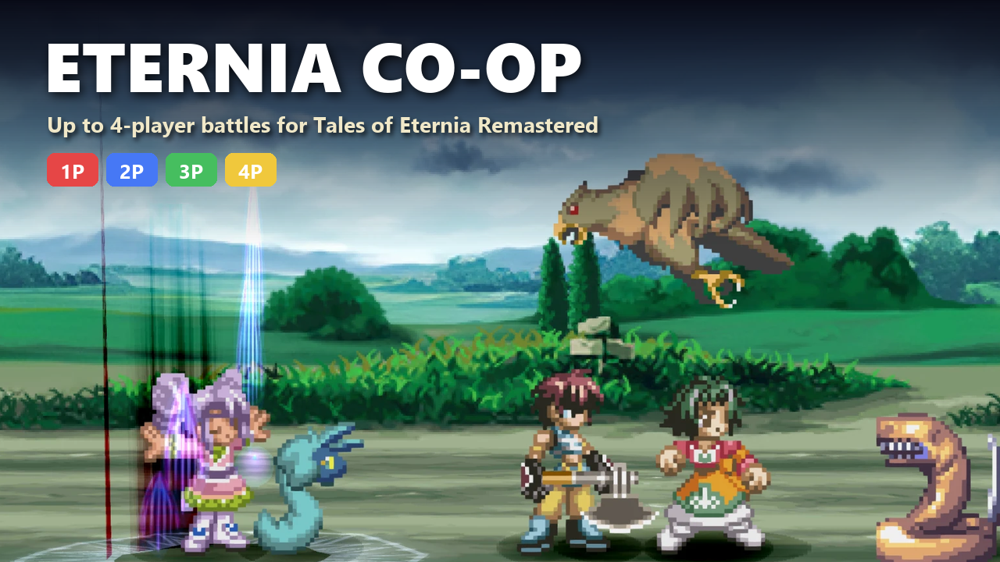
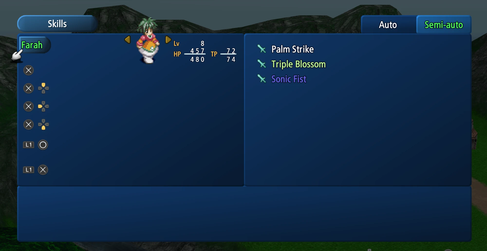
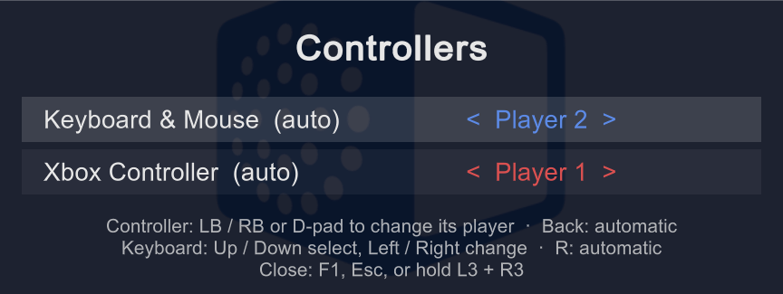

# Eternia Co-op

**Download:** [latest release](https://github.com/thewhitejesus/EterniaCoop/releases/latest) ·
[Nexus Mods](https://www.nexusmods.com/talesofeterniaremastered/mods/10)

Local 2–4 player co-op for **Tales of Eternia Remastered** (Steam, PC). Like the PS1 original's multitap mode:
player 1 controls the leader, and players 2–4 each control another party member in battle.

The remaster is based on the PSP version, which removed multiplayer. The battle engine still has the PS1's
per-character input slots - this mod fills them again.

## Features

- **Up to 4 players in battle.** Each controller drives its own party member.
- **Automatic controller assignment.** Plug in a controller and that player's character switches to Semi-Auto;
  unplug it and the character goes back to Auto (AI). Works mid-battle too.
- **Semi-Auto / Auto tab for every party member** in the Skills menu (the game normally shows it only for the leader).
- **Control modes stay set after battles** (the game used to reset them to Auto).
- **Per-player rumble:** each player's controller rumbles for their own character's hits, like the PS1.
- **Co-op camera:** with two or more players, the battle camera centres between everyone and zooms out smoothly as
  you spread apart, so nobody fights off-screen. If player 1's character is knocked out it follows the others; spell
  cameras and the battle menu's manual pan work as usual.
- **Controller manager** (F1, or hold L3 + R3): choose which controller is which player - fully usable with a
  controller, drawn in Tales of Eternia's own style with the party's artwork from your copy of the game. Any device
  can be turned off (handy for Parsec).
- **Field control:** pick which player walks the party and uses the camp menu outside battle (equipment, artes...),
  so everyone can manage their own character. Battles are unaffected.
- **Survives game updates:** the mod finds every spot it uses in the game's code by its signature, so when an update
  moves code around it adapts by itself ("adapted to a game update" on the main menu). Anything it can't find with
  certainty stays off - nothing is half-applied - and works alongside other mods that change the game's code.
- Small "Eternia Co-op" label in the top-right corner of the main menu while the mod is running (hidden in game),
  with the controller-manager key and the other mods running alongside it (BepInEx plugins, Guests from Phantasia,
  ASI mods, ReShade).
- **Works with BepInEx 6 mods too:** the download includes the **BepInEx 6 Bridge**, which runs mods built for
  BepInEx 6 (Uncropped Backgrounds, Fast Shutdown, Font Replacer) on this mod's BepInEx 5 - so you don't have to
  choose between them. Tested with all three, plus 100% Drop and Steal Rate and Guests from Phantasia.

## Screenshots

**Semi-Auto/Auto for every party member** (normally only the leader gets this tab):

**Controller manager** (F1, or hold L3 + R3):

## What this mod does (and doesn't) do to your PC

- **No internet access, telemetry or tracking** of any kind - the mod never opens a network connection.
- **No game files are modified.** All changes happen in memory while the game runs; delete the mod and the game
  is exactly as before. Steam's "Verify integrity of game files" stays clean.
- **Writes only its own settings file** (`BepInEx\config\eterniacoop.cfg`). The only game data it touches is each party
  member's Semi-Auto/Auto setting, which the game saves the same way as when you change it in the menu.
- **No admin rights, no registry changes, nothing runs in the background** after you close the game.
- **All source code is public** (MIT license) - it's all in this repository.
- Uses [BepInEx](https://github.com/BepInEx/BepInEx), the standard Unity mod loader. Its `winhttp.dll` is
  occasionally flagged by over-eager antivirus software; it's the same file used by thousands of Unity mods.
- Single-player game only - there are no online features or anti-cheat involved.

## Install

1. Extract the zip into the game folder (Steam → right-click the game → Manage → Browse local files), so that
   `winhttp.dll` and the `BepInEx` folder sit next to `Tales of Eternia Remastered.exe`.
2. Start the game. "Eternia Co-op 1.3.0" appears in the top-right corner of the main menu.
3. Connect controllers. Player 1 keeps the keyboard and the first controller; controllers 2–4 become players 2–4.
   To change who is who, open the controller manager (below).

## Steam Deck / Linux (Proton)

Not tested yet - reports welcome. The mod itself has nothing Windows-only beyond what Proton provides; the one
extra step is the one every BepInEx mod needs on Proton:

1. Install as above (on a Deck: Desktop Mode → Steam → right-click the game → Manage → Browse local files).
2. Steam → right-click the game → **Properties** → **Launch Options**, enter:
   `WINEDLLOVERRIDES="winhttp=n,b" %command%`
   Without it Proton ignores BepInEx's `winhttp.dll` and the mod silently doesn't load (no label on the main menu).
3. Leave Steam Input **on** for the Deck's own controls. Extra controllers (USB or Bluetooth) become players 2–4.
4. No keyboard: open the controller manager by holding **L3 + R3** (both sticks pressed in).

`BepInEx\LogOutput.log` says "Running under Wine/Proton" when the mod loaded there.

## Controller manager

Open with **F1**, or hold **L3 + R3** (both sticks pressed in) on any controller - handy for Parsec guests.
Both shortcuts can be changed in the settings (`ManagerKey`, `ManagerControllerShortcut`).
With **100% Drop and Steal Rate** installed (it opens its own menu with F1), the key is **F8** instead; with
**Guests from Phantasia** installed (it toggles its guest with L3 + R3), the controller shortcut is **LB + RB + Back**.
The game ignores input while it's open.

- **Any controller:** D-pad or left stick up/down picks a row, left/right changes its player (Off, P1-P4; hold to
  repeat). **A** jumps to your own controller's row, **LB / RB** move your own controller, **Y** resets everything
  to automatic, **B** closes.
- **Keyboard:** arrow keys (or W/A/S/D) the same, R resets to automatic, Esc or Enter closes.
- **Off:** a device set to Off controls nobody - e.g. turn off Keyboard & Mouse when playing over Parsec, where
  guests' keyboards act as the host's (or set `KeyboardPlayer = -1`).
- A row lights up when you press something on that device, so you can tell identical controllers apart.
- Choices are saved; if controllers are plugged in a different order next time, they may swap - just reopen the manager.
- Player 1 always keeps at least one device (otherwise nobody could use the menus).
- It's drawn with the game's own font - or, with **Font Replacer** (vitruvianesse) and **Font of Eternia** (Jyrakos)
  installed, with that font, to match the rest of the game. Neither is included with this mod.

## Playing online (Parsec / Steam Remote Play)

The game has no Steam Remote Play Together support, but friends can join through **Parsec**: their controllers
show up on the host PC as extra controllers and become players 2–4. Third-party tools that force Remote Play
Together (e.g. "Remote Play Whatever") may also work but are not tested.

- If a controller shows up twice, turn off Steam Input for the game (Steam → game Properties → Controller).
  Not on a Steam Deck, where the built-in controls need it.
- Windows supports up to 4 Xbox-style controllers at once: the host's plus 3 guests.

## BepInEx 6 mods (the bridge)

Some Tales of Eternia mods are built for BepInEx 6 while this one uses BepInEx 5, and a game runs only one.
The included **BepInEx 6 Bridge** (`BepInEx\plugins\BepInEx6Bridge\`) runs BepInEx 6 mods on BepInEx 5:

1. Install this mod as usual. **Coming from BepInEx 6?** Extract over it - the game switches to BepInEx 5's loader
   and your mods and settings stay.
2. Install the BepInEx 6 mods into `BepInEx\plugins\` as their pages say (only the mod, not BepInEx 6 itself).
   Font Replacer also needs its font (Font of Eternia) in its folder.
3. `BepInEx\LogOutput.log` lists each one as "Started BepInEx 6 plugin ...", and the main menu shows them under
   "Also running".

It's a separate plugin: delete that folder to remove it, and it does nothing when no BepInEx 6 mods are installed.
Details in [bridge/README.md](bridge/README.md). Also available on its own (`BepInEx6Bridge-<version>.zip`).

## Settings

`BepInEx\config\eterniacoop.cfg` (created on first start):

| Setting | Default | What it does |
|---|---|---|
| `ForcePlayerCount` | 4 | Number of players. 0 turns co-op off. |
| `AutoAssignControllers` | true | Assign controllers to players automatically (and enable the controller manager). |
| `DeviceAssignments` | (empty) | Saved by the controller manager. Clear it to go back to fully automatic. |
| `KeyboardPlayer` | 0 | Player who gets keyboard + mouse (0 = player 1). Set 1 to test alone: keyboard = player 2. -1 = off (e.g. for Parsec). |
| `FieldControl` | 0 | Player (0-3) who controls the field and menus outside battle (0 = player 1). Also in the controller manager. |
| `JoinMode` | 1 | Mode for a party slot when its player connects (1 = Semi-Auto). |
| `KeepSlotModesAfterBattle` | true | Don't reset players 2–4 to Auto after battles. |
| `MenuModeTabForAll` | true | Semi-Auto/Auto tab in the Skills menu for everyone. |
| `LiveModeSync` | true | Join / drop out mid-battle. |
| `PerPlayerRumble` | true | Rumble each player's own controller. Follows the game's rumble option. |
| `CoopCamera` | true | With 2+ players, the battle camera follows everyone and zooms out as they spread apart. Off = the game's camera. |
| `CoopCameraMaxZoom` | 720 | How far the co-op camera may zoom out (512 = no zoom, 668 = the game's own farthest). Beyond about 730 the view reaches past the bottom of the battle picture. |
| `ManagerKey` | F1 | Keyboard key that opens the controller manager. |
| `ManagerControllerShortcut` | L3+R3 | Controller buttons to hold to open it: `L3+R3`, `LB+RB+Back`, `Back+Start` or `None`. |
| `ShowWatermark` | true | The corner label on the main menu. |
| `StrictVersionCheck` | false | Stay off completely unless the game file is exactly the supported build (otherwise only features whose game code changed are turned off). |

## Known limitations

- **Tested with 2 players** (controller + keyboard). 3–4 players and Parsec should work - please report how it goes.
- **Menus, the field and cutscenes are controlled by one player**, player 1 as on the PS1 (or whoever Field control
  picks). Co-op is for battles.
  Any player can open the **battle menu** (Start, or Tab on the keyboard): while it's open only the player who opened
  it controls it (everyone, if the battle was paused with Start).
- **Other mods:** tested together with 100% Drop and Steal Rate (works; the manager moves to F8) and Guests from
  Phantasia (works: the guest fights on AI in the empty slot; with a full party of 4 it replaces the 4th member,
  so with 4 players set `ReplaceFourth=0` in its `ToE_Guest.ini`). BepInEx 6 mods (**Uncropped Backgrounds,
  Fast Shutdown, Font Replacer**) work too, through the included BepInEx 6 Bridge - see below.
- **Saved controller choices can swap** if controllers are plugged in a different order - reopen the manager.
- **A controller shows up twice?** Turn off Steam Input for the game (Steam → game Properties → Controller).

## Troubleshooting

- **Label says "partly on (off: ...)"** - a game update or another mod changed the code those features need, so
  they were left off; everything else works. `BepInEx\LogOutput.log` lists exactly what differed.
- **Label says "off: game code not recognized"** - the game was updated in a way the mod can't handle yet. Wait for
  a mod update; the game runs unmodified until then.
- **No label at all** - BepInEx isn't loading. Check that `winhttp.dll` is next to the game's .exe and that your
  antivirus didn't remove it. `BepInEx\LogOutput.log` shows what happened. On Steam Deck / Linux, add the launch
  option from the Steam Deck section.
- **Player 2's character stands still** - that slot is on Semi-Auto but player 2 has no controller assigned.
  Check the controller, or set the character back to Auto in the Skills menu.
- **Saves:** the mod changes nothing in save files except the party members' Semi-Auto/Auto setting, which the
  game saves normally. Backing up saves before trying any mod is still a good idea
  (`%LOCALAPPDATA%\BANDAI NAMCO Entertainment\Tales of Eternia Remastered\Saved`).

## Uninstall

Delete `winhttp.dll`, `doorstop_config.ini`, `.doorstop_version`, `changelog.txt`, `EterniaCoop-README.md` and the
`BepInEx` folder from the game folder. The game's own files are never modified.

## Building from source

Windows only; no SDK needed - the build uses the C# compiler that ships with Windows.

1. Install the mod (or plain BepInEx 5.4.23.5 x64) into the game once, so `BepInEx\core` exists.
2. `powershell -ExecutionPolicy Bypass -File build.ps1` builds and installs `EterniaCoop.dll`. The game folder is
   found through Steam; set `TOE_GAME_DIR` or pass `-Game <folder>` to override.
3. `build.ps1 -DebugBuild` adds the research tools; `package.ps1` makes the release zips (it needs
   `BepInEx_win_x64_5.4.23.5.zip` from the [BepInEx releases](https://github.com/BepInEx/BepInEx/releases) next to it).

Developers and AI assistants: start with [AGENTS.md](AGENTS.md).

## Credits and license

Created by thewhitejesus1 with Claude (Anthropic) - full credits in [CREDITS.md](CREDITS.md).

**Open source and free to share or modify.** Eternia Co-op is MIT licensed ([LICENSE](LICENSE)): reupload it, fork it,
include it in modpacks or build on it - just keep the license and credits. Bundled third-party components keep
their own licenses (in `licenses\`). Not affiliated with or endorsed by Bandai Namco Entertainment.
For how the mod works internally, see [AGENTS.md](AGENTS.md).
